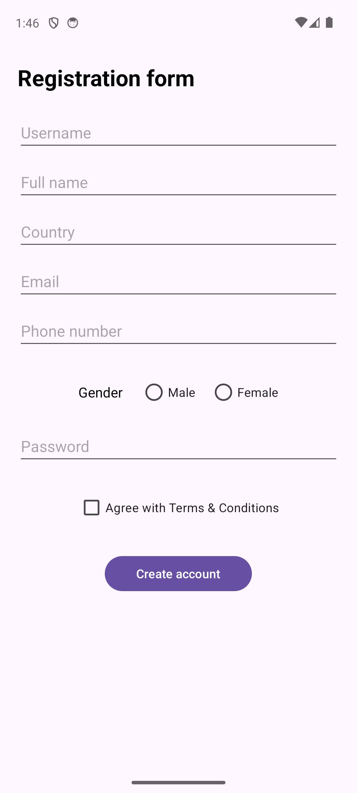
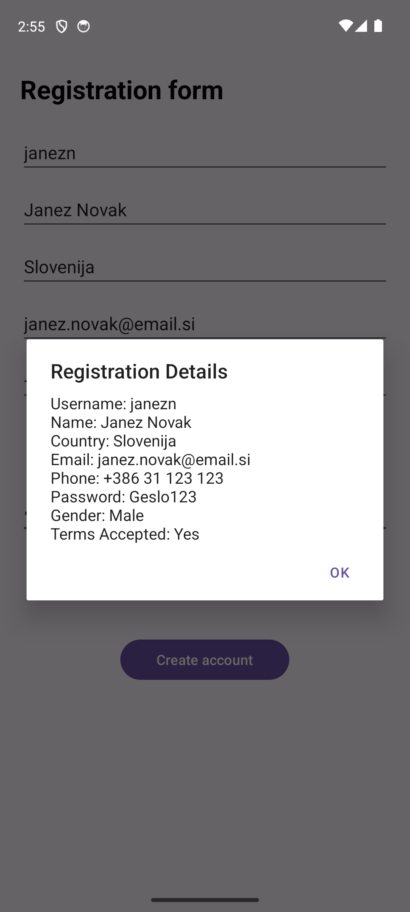

# Registracijski obrazec

Preprosta Android aplikacija z registracijskim obrazcem, narejena pri predmetu MOAp. Namen naloge je spoznavanje vnosnih polj, izbire možnosti in prikaza vnesenih podatkov v pogovornem oknu.

## Opis aplikacije

Aplikacija vsebuje naslednje elemente uporabniškega vmesnika:
- Drsno postavitev (`ScrollView`), ki omogoča pregledno uporabo obrazca na vseh velikostih zaslona.
- Vnosna polja za uporabniško ime, polno ime, državo, e-pošto, telefonsko številko in geslo.
- Dva radio gumba (**Male** in **Female**) za izbiro spola.
- Potrditveno polje za sprejem pogojev poslovanja (**Terms of service**).
- Gumb za oddajo (**Submit**), ki ob kliku odpre pogovorno okno (AlertDialog) s povzetkom vseh vnesenih podatkov.

Vsa besedila v aplikaciji so shranjena v `strings.xml`.

## Posnetki aplikacije

 
